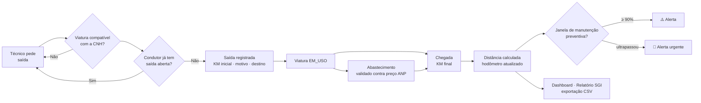
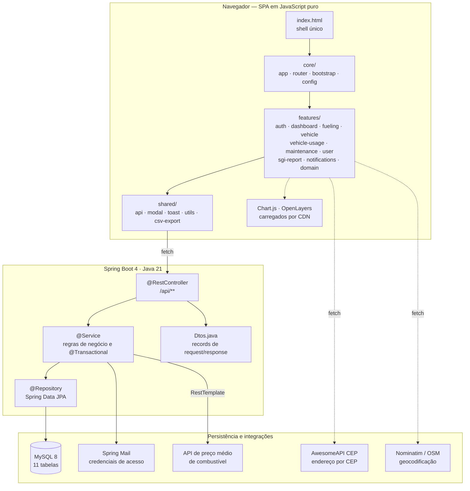
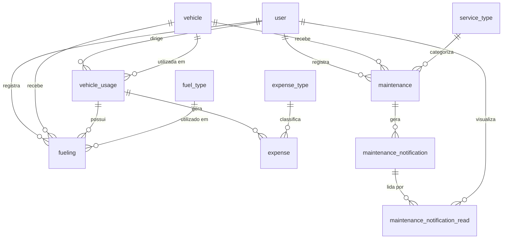

<h1 align="center">Trabalho de Graduação — Portfólio Acadêmico</h1>

<p align="center">
  
</p>

<h3 align="center">Matheus de Paula</h3>
<p align="center">
  <sub>Tecnologia em Banco de Dados · FATEC São José dos Campos</sub>
</p>

<p align="center">
  <a href="https://github.com/MrMatheTrue"></a>
  <a href="https://www.linkedin.com/in/matheus-de-paula-a547161a6/"></a>
  
</p>

<p align="center">
  <a href="#-sobre-mim">Sobre mim</a> ·
  <a href="#-stack-técnica">Stack</a> ·
  <a href="#-linha-do-tempo-acadêmica">Linha do tempo</a> ·
  <a href="#-3º-semestre--flowtrack">FlowTrack (3º sem.)</a> ·
  <a href="#-onde-usei-cada-tecnologia">Tecnologias</a> ·
  <a href="#-contribuições-pessoais">Contribuições</a> ·
  <a href="#-demais-semestres">Demais semestres</a> ·
  <a href="#-contato">Contato</a>
</p>

---

## 👤 Sobre mim

### Da quadra para o código

**Treze anos dedicados ao handebol de alto rendimento** me ensinaram disciplina, trabalho em equipe e resiliência. Defendi a **Seleção Brasileira** nas categorias Juvenil e Júnior e atuei em clubes europeus até os 21 anos.

A transição para a tecnologia foi natural: a mesma mentalidade que me levou às quadras da Europa trouxe resultados rápidos na programação. **Seis meses após iniciar a graduação**, conquistei meu primeiro estágio na **Antolin**, multinacional do setor automotivo.

Desde então, venho construindo uma base sólida em **dados e desenvolvimento**:

- **Analytics de Dados** na Ouvidoria do **Santander**
- **Analista de Dados** na **Sabesp** (via prestadora)
- **Gerente de Projetos e Desenvolvedor** na **Marcelo Melo Building Support**
- **Desenvolvedor FullStack** na **DRM Educação**, com foco em back-end

Hoje aplico a mesma dedicação que me tornou atleta profissional para resolver problemas complexos com código. Acredito que **grandes desafios exigem comprometimento total** — seja na quadra ou no desenvolvimento de software.

---

Atualmente curso **Tecnologia em Banco de Dados** na FATEC São José dos Campos, com foco em **desenvolvimento back-end** e **modelagem e administração de bancos de dados relacionais**.

Ao longo da graduação atuo nos projetos integradores (API) com empresas parceiras reais, aplicando **Scrum** em três sprints por semestre — do levantamento de requisitos com o cliente até a entrega em produção e a apresentação na Feira de Soluções.

O que me interessa tecnicamente é transformar processo manual em sistema rastreável: modelar o domínio direito, impedir o dado inconsistente na origem em vez de corrigi-lo depois, e expor indicadores que sustentem decisão gerencial em vez de apenas armazenar registros.

**Foco atual:** Java 21 + Spring Boot, SQL e modelagem relacional, containerização com Docker e boas práticas de versionamento e documentação técnica.

---

## 🧰 Stack técnica

<p align="center">
  &nbsp;&nbsp;
  &nbsp;&nbsp;
  &nbsp;&nbsp;
  &nbsp;&nbsp;
  &nbsp;&nbsp;
  &nbsp;&nbsp;
  
</p>
<p align="center">
  &nbsp;&nbsp;
  &nbsp;&nbsp;
  &nbsp;&nbsp;
  &nbsp;&nbsp;
  &nbsp;&nbsp;
  &nbsp;&nbsp;
  &nbsp;&nbsp;
  
</p>

| Camada | Tecnologias |
| :----- | :---------- |
| **Linguagens** | Java 21 · JavaScript (ES6+) · Python · SQL · HTML5 · CSS3 |
| **Back-end** | Spring Boot · Spring Data JPA · Spring MVC · Spring Mail · Hibernate · Lombok · Maven |
| **Dados** | MySQL · PostgreSQL · Modelagem relacional (MER) · Dicionário de dados |
| **Front-end** | JavaScript modular (SPA sem framework) · Chart.js · OpenLayers · CSS custom properties |
| **Infra e processo** | Docker (multi-stage) · Git/GitHub · Jira · Scrum · IntelliJ IDEA · Figma |

---

## 🗓️ Linha do tempo acadêmica

| Semestre | Projeto | Empresa parceira | Papel | Stack principal | Status |
| :------- | :------ | :--------------- | :---- | :-------------- | :----- |
| **2026-1 · 3º sem.** | **[FlowTrack](#-3º-semestre--flowtrack)** | IPEM-SP · Regional SJC | Desenvolvedor full-stack | Java 21 · Spring Boot 4 · MySQL 8 · Docker | 🟢 Concluído |
| 2025-2 · 2º sem. | _a preencher_ | _a preencher_ | _a preencher_ | _a preencher_ | ⚪ A documentar |
| 2025-1 · 1º sem. | _a preencher_ | _a preencher_ | _a preencher_ | _a preencher_ | ⚪ A documentar |

---

# 🚗 3º Semestre — FlowTrack

### Sistema de Gestão de Utilização, Abastecimento e Manutenção de Viaturas

<p align="center">
  <a href="https://www.youtube.com/watch?v=61uyiyVtw2M">
    
  </a>
  <br>
  <sub><b>▶️ <a href="https://www.youtube.com/watch?v=61uyiyVtw2M">Assista à demonstração do sistema</a></b></sub>
</p>

### Identificação do projeto

| Item | Detalhe |
| :--- | :------ |
| **Empresa parceira** | IPEM-SP — Instituto de Pesos e Medidas do Estado de São Paulo, Regional de São José dos Campos |
| **Equipe** | LizardsDBA — 9 integrantes |
| **Meu papel** | Desenvolvedor full-stack |
| **Duração** | 3 sprints de 3 semanas (16/03 a 31/05) + Feira de Soluções (18/06) |
| **Metodologia** | Scrum — backlog no Jira, DoR/DoD por sprint, burndown, PR revisado |
| **Repositório (documentação)** | [LizardsDBA/API-2026-3](https://github.com/LizardsDBA/API-2026-3) |
| **Repositório (aplicação)** | [LizardsDBA/flow-track](https://github.com/LizardsDBA/flow-track) — 230 commits |
| **Demonstração** | [▶️ Vídeo no YouTube](https://www.youtube.com/watch?v=61uyiyVtw2M) |
| **Board de tarefas** | [Alocação de tarefas — Jira](https://lizardsdba.github.io/API-2026-3-tarefas/) |

---

## 🎯 Problema

O IPEM-SP, Regional de São José dos Campos, controlava o abastecimento e a utilização da frota por meio de **pranchetas físicas mantidas dentro dos próprios veículos**. Os técnicos anotavam à mão quilometragem, litros, valor pago e número da nota fiscal.

| Sintoma | Consequência operacional |
| :------ | :----------------------- |
| Registro manuscrito e disperso entre veículos | Consolidação mensal demorada e sujeita a erro de transcrição |
| Ausência de base centralizada | Impossível comparar consumo entre viaturas |
| Nenhum cálculo automático de eficiência | Consumo médio (km/L) desconhecido — ineficiência invisível |
| Sem histórico estruturado de quilometragem | Manutenção preventiva sem gatilho confiável |
| Nenhuma validação no lançamento | Preço por litro e volume aceitos sem crítica |
| Dupla digitação para o SGI | Retrabalho e nova janela de erro |

---

## 💡 Solução

O **FlowTrack** cobre o ciclo completo de uso de uma viatura, da saída ao indicador gerencial:



### Entregas por eixo

| Eixo | O que foi entregue |
| :--- | :----------------- |
| **Registro operacional** | Abastecimento com nota fiscal e crítica automática de preço; saída e chegada de viatura com cálculo de distância |
| **Cadastros** | Usuários (matrícula + categoria de CNH), viaturas, tipos de combustível e tipos de serviço |
| **Controle de acesso** | Dois perfis — Técnico e Administrador — com menu e escopo de dados distintos |
| **Conformidade** | Viaturas filtradas pela CNH do condutor; bloqueio de saída dupla pelo mesmo condutor |
| **Auditoria** | Detecção automática de abastecimento anômalo, com validação manual pelo administrador |
| **Manutenção** | Alertas em 90 % do intervalo e após ultrapassagem, com leitura controlada por usuário |
| **Gestão** | Dashboard com KPIs e gráficos Chart.js, mapa de destinos, Relatório SGI e exportação CSV |

---

## 🏗️ Arquitetura



### Decisões de arquitetura

| Decisão | Justificativa |
| :------ | :------------ |
| **SPA em JavaScript puro**, sem React ou Vue | O front é servido como conteúdo estático pelo próprio Spring Boot — um único artefato `.jar` sobe a aplicação inteira. Sem build step, sem `node_modules`, sem divergência de versão entre as 9 máquinas da equipe |
| **Composição por `Object.assign(app, {...})`** | Cada arquivo de feature estende o mesmo objeto global `app`. Dá modularidade por arquivo sem bundler, e qualquer módulo acessa os utilitários compartilhados |
| Camadas **Controller → Service → Repository** | A regra de negócio vive no Service e é testável sem subir HTTP. O Controller só traduz requisição e resposta |
| **DTOs como `record`** | Java 21 permite contratos imutáveis em uma linha, sem getters, setters ou Lombok no DTO. Impede que a entidade JPA vaze para o cliente |
| **`createDatabaseIfNotExist=true`** | O avaliador roda um comando e o schema nasce sozinho — sem script SQL manual na banca |
| **Soft delete** (`active BOOLEAN`) | Usuário ou viatura desativado continua referenciado no histórico. Exclusão física quebraria a auditoria do órgão |
| **Flags `alert_sent` / `urgent_alert_sent`** | Garantem idempotência: cada patamar de alerta dispara uma única vez, por mais que o hodômetro seja atualizado |
| **Leitura em tabela separada** (`maintenance_notification_read`) | Separa "a notificação existe" de "este usuário a viu". Com dois administradores, o aviso lido por um continua pendente para o outro |
| **Docker multi-stage** | O estágio de build usa a imagem Maven completa; a final só o JRE. A imagem entregue não carrega compilador nem código-fonte |
| **Seed com `Random(42)`** | Semente fixa torna o conjunto de dados de demonstração reprodutível — toda apresentação mostra exatamente os mesmos números |

---

## 📁 Estrutura do projeto

```
flow-track/
├── src/main/java/br/edu/fatec/api/flowtrack/
│   ├── controller/          AuthController · UserController · VehicleController
│   │                        VehicleUsageController · FuelingController
│   │                        MaintenanceController · NotificationController
│   │                        DomainController · MockAnpController
│   ├── service/             UserService · VehicleService · VehicleUsageService
│   │                        FuelingService · MaintenanceService
│   │                        AnomalyDetectionService · NotificationService · EmailService
│   ├── repository/          Interfaces Spring Data JPA (queries derivadas e @Query)
│   ├── entity/              User · Vehicle · VehicleUsage · Fueling · Maintenance
│   │                        ServiceType · FuelType · MaintenanceNotification …
│   ├── dto/Dtos.java        Records de request e response
│   └── config/              CorsConfig · DataInitializer (@Profile("local"))
│
├── src/main/resources/static/
│   ├── index.html           Shell da SPA
│   ├── css/main.css         Design system em CSS custom properties
│   └── js/
│       ├── core/            config · app · router · bootstrap
│       ├── shared/          api · utils · toast · modal · ui · helpers · csv-export
│       └── features/        auth · dashboard · vehicle-usage · vehicle
│                            fueling · maintenance · user · sgi-report
│                            notifications · domain
│
├── Dockerfile               Build multi-stage
└── pom.xml                  Java 21 · Spring Boot 4.0.4
```

---

## 🗄️ Modelo de dados

11 tabelas em três grupos.

| Grupo | Tabelas |
| :---- | :------ |
| Cadastros base | `user` · `vehicle` · `fuel_type` · `expense_type` · `service_type` |
| Registros operacionais | `vehicle_usage` · `fueling` · `expense` · `maintenance` |
| Notificações | `maintenance_notification` · `maintenance_notification_read` |



📄 Dicionário completo: [`docs/manuais/Dicionario_de_Dados.md`](./docs/manuais/Dicionario_de_Dados.md)

---

## 📋 Backlog e sprints

| # | Prioridade | User Story | SP | Sprint | Status |
| :- | :--------- | :--------- | :-: | :----: | :----: |
| 1 | Alta | Registrar abastecimento (viatura, KM, litros, valor, NF) | 5 | 1 | 🟢 |
| 2 | Alta | Gerenciar os cadastros do sistema | 5 | 1 | 🟢 |
| 3 | Alta | Comprovar o valor gasto no abastecimento | 5 | 1 | 🟢 |
| 4 | Média | Iniciar uso de viatura (prefixo, KM inicial, data, finalidade) | 5 | 2 | 🟢 |
| 5 | Média | Encerrar uso e calcular a quilometragem percorrida | 3 | 2 | 🟢 |
| 6 | Média | Consultar histórico completo de utilização | 5 | 2 | 🟢 |
| 7 | Baixa | Receber avisos de manutenção preventiva por quilometragem | 5 | 3 | 🟢 |
| 8 | Baixa | Visualizar indicadores (consumo médio, KM, gastos por viatura) | 8 | 3 | 🟢 |
| 9 | Baixa | Gerar relatórios consolidados para o SGI | 5 | 3 | 🟢 |

**9 user stories · 46 story points · 3 sprints · 100 % entregue.**

| Sprint | Período | Sprint Goal | SP |
| :----- | :------ | :---------- | :-: |
| [1](./docs/processo/sprints/sprint-1/README.md) | 16/03 – 05/04 | Registro de abastecimentos e cadastros base | 15 |
| [2](./docs/processo/sprints/sprint-2/README.md) | 13/04 – 03/05 | Controle de utilização das viaturas e histórico | 13 |
| [3](./docs/processo/sprints/sprint-3/README.md) | 11/05 – 31/05 | Manutenção preventiva, indicadores e relatórios | 18 |

---

## 🛠️ Onde usei cada tecnologia

Esta seção descreve **em que ponto do FlowTrack cada tecnologia foi aplicada** e por que ela foi escolhida.

---

###  Java 21

**Usei o Java 21 como linguagem de todo o back-end** — as nove classes de serviço, os nove controladores REST, as entidades JPA e os DTOs.

Três recursos da versão mudaram concretamente o código que escrevi:

- **`record`** — todos os DTOs de entrada e saída (`LoginRequest`, `MaintenanceResponse`, `OpenVehicleUsageRequest`…) são records declarados em um único arquivo `Dtos.java`. Contratos imutáveis sem getter, setter, `equals` ou `hashCode` escritos à mão.
- **Text blocks (`"""`)** — usei para montar o corpo HTML do e-mail de boas-vindas no `EmailService`, mantendo o template legível dentro do Java em vez de concatenar dezenas de strings.
- **`String.formatted()`** — usei na composição das mensagens de alerta de manutenção, mais direto que `String.format` encadeado.

> A versão 21 é LTS e é um requisito rígido do projeto: compilar com JDK 17 quebra o build.

---

###  Spring Boot 4.0.4

**Usei o Spring Boot como framework de toda a aplicação** — ele serve a API REST, entrega o front-end estático e sobe o servidor embarcado no mesmo processo.

| Módulo do Spring | Onde apliquei |
| :--------------- | :------------ |
| **Spring MVC** (`spring-boot-starter-webmvc`) | Os nove `@RestController` sob `/api/**`. Usei `@PostMapping(consumes = MULTIPART_FORM_DATA_VALUE)` no registro de abastecimento para receber o formulário com o comprovante, e `@PatchMapping` nas transições de estado (`/close`, `/cancel`, `/{id}/read`) por serem alterações parciais de recurso |
| **Spring Data JPA** | Todos os repositórios. Detalhado na seção do Hibernate |
| **Injeção de dependência** | Via construtor, com `@RequiredArgsConstructor` do Lombok. Nenhum `@Autowired` em campo — dependências `final` deixam explícito o que cada serviço precisa para existir |
| **`@Transactional`** | Nos métodos que tocam mais de uma entidade: `VehicleUsageService.close()` grava o uso, atualiza o hodômetro, libera a viatura e dispara a checagem de alertas — ou tudo acontece, ou nada |
| **`@Profile("local")`** | No `DataInitializer`, que limpa e repovoa o banco. Isola a carga de demonstração do ambiente real: sem o profile ativo, a classe sequer é instanciada |
| **`RestTemplate`** | No `AnomalyDetectionService`, para consultar o preço médio do combustível antes de aprovar um lançamento |
| **Spring Mail** (`JavaMailSender`) | No `EmailService`, que envia as credenciais ao usuário recém-cadastrado |
| **Recursos estáticos** | A SPA em `src/main/resources/static/` é servida pelo próprio Boot — sem Nginx, sem servidor separado |
| **DevTools** | Hot reload durante o desenvolvimento, evitando reiniciar a aplicação a cada ajuste |

---

###  Spring Data JPA · Hibernate

**Usei o Spring Data JPA como camada de persistência** para as 11 entidades, em três estilos conforme a complexidade da consulta:

- **Queries derivadas do nome do método** — para as buscas diretas: `findByRegistration`, `findByStatusAndActiveTrue`, `existsByDriverIdAndStatus`, `countByActiveTrue`. O Spring gera o SQL a partir do nome, sem uma linha de implementação.
- **`@Query` nomeada** — nas consultas analíticas que alimentam o dashboard: `findAveragePriceByFuelType`, `findMaxMileageByVehicleId`, `findPreventiveByVehicleOrderByDateDesc`.
- **Filtros dinâmicos com `Pageable`** — `findWithFilters(...)` recebe período, prefixo, status e motivo, todos opcionais, e devolve `Page<T>`. Os relatórios paginam no banco em vez de carregar tudo na memória.

Também usei `@Builder` do Lombok nas entidades, o que torna a criação de um `VehicleUsage` com dez campos legível e sem construtor telescópico.

---

###  MySQL 8

**Usei o MySQL como banco relacional**, com o schema gerado pelo Hibernate a partir das entidades.

Tipos escolhidos por motivo específico:

| Tipo | Onde | Por quê |
| :--- | :--- | :------ |
| `DECIMAL(10,2)` | `total_amount`, `cost`, `amount` | Valor monetário em `FLOAT` acumula erro de arredondamento. Toda a aritmética financeira usa `BigDecimal` no Java e `DECIMAL` no banco |
| `DECIMAL(8,3)` | `liters` | Litros exigem três casas — a bomba de combustível trabalha em milésimos |
| `ENUM` | `status`, `type`, `reason` | Domínios fechados e definidos no código, validados pelo próprio SGBD |
| `LONGBLOB` | `receipt` | O comprovante fiscal vive na mesma transação do lançamento — não existe lançamento sem comprovante nem arquivo órfão |
| `UNIQUE (notification_id, user_id)` | `maintenance_notification_read` | Impede, na camada do banco, que o mesmo usuário registre duas leituras da mesma notificação |

---

###  JavaScript ·  HTML5 ·  CSS3

**Usei JavaScript puro para construir a SPA inteira** — sem React, sem Vue, sem bundler.

A arquitetura é uma composição: `index.html` carrega vinte scripts em ordem, e cada um estende o mesmo objeto global com `Object.assign(app, { ... })`. O resultado é modularidade por arquivo sem build step.

| Camada | Arquivos | Responsabilidade |
| :----- | :------- | :--------------- |
| `core/` | `config` · `app` · `router` · `bootstrap` | Estado da sessão, roteamento por `navigate(screen)`, montagem do menu conforme o perfil |
| `shared/` | `api` · `utils` · `toast` · `modal` · `ui` · `helpers` · `csv-export` | `fetch` centralizado, modais, notificações, máscaras e exportação |
| `features/` | 10 módulos | Uma tela por módulo, cada um com seu `render`, seus modais e seus handlers |

Detalhes que resolvi no front:

- **Máscara decimal brasileira** — `maskDecimal(input, casas)` formata o valor enquanto o usuário digita e `parseDecimalBR` converte `1.234,56` para o float que a API espera. Sem isso, o técnico em campo digitaria vírgula e o back-end receberia `NaN`.
- **Upload multipart** — o abastecimento é enviado com `FormData` para transportar o comprovante junto com os campos no mesmo POST.
- **Validação espelhada** — o KM de chegada é checado no navegador *e* no serviço. A primeira dá resposta imediata; a segunda é a que de fato garante o dado.
- **CSS custom properties** — `var(--primary)`, `var(--text-muted)`, `var(--border)` formam um design system enxuto em `main.css`, consistente entre as dez telas.

---

###  Docker

**Usei o Docker para padronizar o ambiente e viabilizar o deploy**, com `Dockerfile` **multi-stage**:

```dockerfile
# Estágio 1 — build com Maven e JDK 21
FROM maven:3.9.6-eclipse-temurin-21 AS build
WORKDIR /app
COPY pom.xml .
RUN mvn dependency:go-offline     # cacheia dependências antes do código-fonte
COPY src ./src
RUN mvn clean package -DskipTests

# Estágio 2 — imagem final, apenas JRE
FROM eclipse-temurin:21-jre
WORKDIR /app
COPY --from=build /app/target/*.jar app.jar
EXPOSE 8080
ENTRYPOINT ["java", "-jar", "app.jar"]
```

Duas decisões conscientes: copiar o `pom.xml` **antes** do código-fonte faz o Docker cachear a camada de dependências — alterar uma classe Java não rebaixa o download inteiro do Maven; e separar os estágios mantém fora da imagem final o compilador, o Maven e o código-fonte, deixando apenas o `.jar` sobre um JRE.

---

###  Maven

**Usei o Maven para build e gestão de dependências.** O `pom.xml` herda do `spring-boot-starter-parent`, o que centraliza as versões compatíveis de todo o ecossistema Spring em um único ponto.

O projeto inclui o **Maven Wrapper** (`mvnw`), então quem clona não precisa ter o Maven instalado — o próprio script baixa a versão correta. Com 9 integrantes em máquinas diferentes, isso elimina a classe inteira de problemas de "na minha máquina funciona".

Comando único de execução: `mvn clean spring-boot:run`.

---

### 📊 Chart.js

**Usei o Chart.js para os gráficos do dashboard** administrativo — custo de combustível por viatura, motivos de uso, top condutores e distribuição por categoria de CNH. Carregado por CDN, sem instalação e sem build.

---

### 🗺️ OpenLayers · AwesomeAPI CEP · Nominatim

Três integrações compõem a camada de geolocalização do sistema.

**OpenLayers — mapa de destinos.** Cada uso de viatura guarda latitude e longitude, e a tela inicial do técnico plota os destinos com marcadores que exibem um tooltip com os dados da viagem. O mapa ajusta o enquadramento sozinho: `animate({zoom: 15})` quando há um único destino, `fit(extent)` quando há vários.

A biblioteca é carregada **sob demanda** — `_loadOpenLayers()` injeta o CSS e o JS só quando a tela do mapa é aberta, e devolve imediatamente se já estiverem presentes. Quem nunca abre o mapa não paga o download.

**AwesomeAPI CEP — preenchimento de endereço.** O campo de destino aceita um CEP; ao completar os 8 dígitos, a máscara dispara a consulta e preenche logradouro, bairro, cidade e UF, **além da latitude e longitude** — é justamente o que permite plotar o destino no mapa depois. Escolhi a AwesomeAPI em vez do ViaCEP porque ela devolve as coordenadas junto com o endereço, economizando uma segunda chamada de geocodificação.

**Nominatim (OpenStreetMap) — geocodificação de texto livre.** Nem todo destino tem CEP à mão. Quando o técnico digita o endereço direto, `geocodeTextoLivre()` consulta o Nominatim restringindo a busca ao Brasil (`countrycodes=br`) e acrescentando "São Paulo, Brasil" quando o texto não menciona o estado — sem isso a busca por "Av. Paulista, 1000" devolveria resultados de outros países.

```javascript
async geocodeTextoLivre(endereco) {
    if (!endereco) return null;
    const appendSP = (q) => /\bSP\b|Brasil|São Paulo/i.test(q)
            ? q : `${q}, São Paulo, Brasil`;
    try {
        const res = await fetch(
            'https://nominatim.openstreetmap.org/search?format=json&limit=1'
            + '&countrycodes=br&addressdetails=1&q=' + encodeURIComponent(appendSP(endereco)),
            { headers: { 'Accept-Language': 'pt-BR', 'User-Agent': 'FlowTrack/1.0' } }
        );
        if (!res.ok) return null;
        const data = await res.json();
        return (data && data.length > 0) ? { lat: data[0].lat, lng: data[0].lon } : null;
    } catch { return null; }
}
```

As três são **open-source ou gratuitas e sem chave de API** — decisão deliberada: um projeto para órgão público não deveria depender de um serviço que exige cartão de crédito para funcionar. Todas falham silenciosamente (`return null`, `catch` vazio): se a geolocalização não resolver, o registro é salvo mesmo assim, apenas sem o ponto no mapa.

---

###  Git e GitHub

**Usei Git com fluxo de branches por sprint:** `feat/* → sprint-X → main`, sem commit direto em `main` ou na branch da sprint.

Adotamos a convenção `tipo<id_tarefa>: descrição` — por exemplo `feat<API-14>: Implementa registro de saída de viatura`. O identificador amarra o commit à tarefa do Jira, e a mesma referência aparece nos logs da aplicação (`[LIZARDS-103]`), o que permite rastrear do log em produção até a user story que originou aquele comportamento.

O repositório da documentação referencia a aplicação como **submódulo Git**, mantendo código e documentação versionados juntos sem misturar os históricos.

---

###  Jira ·  IntelliJ IDEA ·  Figma

- **Jira** — backlog, quebra das user stories em tarefas técnicas e acompanhamento do burndown de cada sprint. É a origem dos identificadores usados nos commits.
- **IntelliJ IDEA** — IDE do time, pela integração nativa com Maven, Spring e depuração do SQL gerado pelo Hibernate.
- **Figma** — wireframes das telas validados com o parceiro antes de virarem código. Pelo DoR, nenhuma user story entrava em sprint sem protótipo aprovado.

---

## 🔧 Contribuições pessoais

> Os trechos abaixo são código real do repositório [`LizardsDBA/flow-track`](https://github.com/LizardsDBA/flow-track).

<details open>
<summary><b>1. Detecção de abastecimento anômalo com validação contra preço de mercado</b></summary>
<br>

O problema que resolvi: nada impedia um lançamento de 0,5 litro, de 300 litros, ou com preço por litro completamente fora da realidade. Em um órgão público, esse é exatamente o tipo de registro que precisa ser revisado.

Implementei o `AnomalyDetectionService`, executado a cada registro de abastecimento, com três críticas em cascata:

1. **Volume irrisório** — abaixo de 1 litro.
2. **Volume excedente** — acima de 200 litros.
3. **Preço discrepante** — preço por litro fora de uma margem de **±30 %** em relação ao preço médio de referência.

O preço de referência vem de uma API externa de preço médio de combustível; se a consulta falhar, o sistema **degrada para a média histórica do próprio banco** em vez de desistir da validação.

```java
@Service
@RequiredArgsConstructor
public class AnomalyDetectionService {

    private final FuelingRepository fuelingRepo;
    private final RestTemplate restTemplate;

    public void analyze(Fueling fueling) {
        fueling.setIsSuspicious(false);
        fueling.setSuspicionReason(null);

        if (fueling.getLiters().compareTo(new BigDecimal("1.0")) < 0) {
            fueling.setIsSuspicious(true);
            fueling.setSuspicionReason("Volume irrisório: Menos de 1 litros abastecidos.");
            return;
        }
        if (fueling.getLiters().compareTo(new BigDecimal("200.0")) > 0) {
            fueling.setIsSuspicious(true);
            fueling.setSuspicionReason("Volume excedente: Mais de 200 litros abastecidos.");
            return;
        }

        BigDecimal currentPricePerLiter =
                fueling.getTotalAmount().divide(fueling.getLiters(), 2, RoundingMode.HALF_UP);

        BigDecimal averagePrice = fetchPriceFromAPI(fueling.getFuelType());
        if (averagePrice == null) {                                  // API indisponível
            averagePrice = fuelingRepo.findAveragePriceByFuelType(   // cai para o histórico
                    fueling.getFuelType());
        }

        if (averagePrice != null && averagePrice.compareTo(BigDecimal.ZERO) > 0) {
            BigDecimal margin   = averagePrice.multiply(new BigDecimal("0.30"));
            BigDecimal minPrice = averagePrice.subtract(margin);
            BigDecimal maxPrice = averagePrice.add(margin);

            if (currentPricePerLiter.compareTo(minPrice) < 0
             || currentPricePerLiter.compareTo(maxPrice) > 0) {
                fueling.setIsSuspicious(true);
                fueling.setSuspicionReason(String.format(
                        "Preço discrepante: R$ %.2f/L. Média aceitável: R$ %.2f/L",
                        currentPricePerLiter, averagePrice));
            }
        }
    }
}
```

**Decisões que tomei aqui:**

- **`BigDecimal` em toda a aritmética**, com `RoundingMode.HALF_UP` explícito na divisão. Valor monetário em `double` acumula erro, e aqui o resultado decide se um lançamento é ou não marcado como suspeito.
- **Sinalizar em vez de bloquear.** O lançamento é sempre gravado — pode haver explicação legítima. O sistema entrega ao administrador uma fila de revisão priorizada, e ele valida pelo endpoint `PATCH /api/fuelings/{id}/approve`, que limpa a marcação.
- **Degradação graciosa.** A indisponibilidade da API externa não derruba o cadastro nem desliga a crítica: o sistema troca a referência por uma menos precisa e segue funcionando.

**Resultado:** de centenas de lançamentos mensais, o administrador revisa apenas os que fogem do padrão, cada um já acompanhado do motivo da suspeita.

</details>

<details>
<summary><b>2. Alertas de manutenção preventiva dirigidos por hodômetro</b></summary>
<br>

A manutenção preventiva dependia da memória do gestor. Implementei um controle que reage ao dado que o técnico **já era obrigado a informar** — a quilometragem — sem exigir trabalho adicional de ninguém.

Sempre que o hodômetro de uma viatura é atualizado (encerramento de uso, registro de manutenção), o método abaixo reavalia todas as manutenções preventivas em aberto daquele veículo:

```java
@Transactional
public void checkMaintenanceAlerts(Integer vehicleId) {
    var vehicle = vehicleRepo.findById(vehicleId).orElse(null);
    if (vehicle == null || vehicle.getCurrentMileage() == null) return;

    int currentMileage = vehicle.getCurrentMileage();
    List<Maintenance> preventiveList = repo.findPreventiveByVehicleOrderByDateDesc(vehicleId);

    for (Maintenance maintenance : preventiveList) {
        if (maintenance.getMileageRecord() == null || maintenance.getNextMileage() == null) continue;

        int mileageRecord = maintenance.getMileageRecord();
        int nextMileage   = maintenance.getNextMileage();
        int difference    = nextMileage - mileageRecord;
        if (difference <= 0) continue;                       // intervalo inválido: ignora

        int alertThreshold = mileageRecord + (int)(difference * 0.90);
        String serviceName = maintenance.getServiceType() != null
                ? maintenance.getServiceType().getName() : "N/A";
        boolean changed = false;

        if (!maintenance.getAlertSent() && currentMileage >= alertThreshold) {
            maintenance.setAlertSent(true);
            changed = true;
            log.info("[LIZARDS-103] Alerta de manutenção: viatura {} atingiu {}km " +
                     "(threshold: {}km, próxima manutenção: {}km) - Serviço: {}",
                     vehicle.getPrefix(), currentMileage, alertThreshold, nextMileage, serviceName);

            notificationService.saveNotification(maintenance, vehicle, NotificationType.ALERT,
                String.format("Viatura %s atingiu 90%% do intervalo de manutenção. " +
                              "Serviço: %s. KM atual: %d, próxima manutenção: %d km.",
                              vehicle.getPrefix(), serviceName, currentMileage, nextMileage));
        }

        if (!maintenance.getUrgentAlertSent() && currentMileage > nextMileage) {
            maintenance.setUrgentAlertSent(true);
            changed = true;
            log.warn("[LIZARDS-103] ALERTA DE URGÊNCIA: viatura {} ultrapassou {}km " +
                     "sem realizar manutenção! KM atual: {} - Serviço: {}",
                     vehicle.getPrefix(), nextMileage, currentMileage, serviceName);

            notificationService.saveNotification(maintenance, vehicle, NotificationType.URGENT,
                String.format("URGENTE: Viatura %s ultrapassou o KM de manutenção! " +
                              "Serviço: %s. KM atual: %d, deveria ter sido feito em: %d km.",
                              vehicle.getPrefix(), serviceName, currentMileage, nextMileage));
        }

        if (changed) repo.save(maintenance);
    }
}
```

**Decisões que tomei aqui:**

- **Dois patamares, não um.** O alerta em 90 % dá tempo de agendar; o urgente sinaliza que o veículo já está operando fora do prazo seguro. Um único aviso no momento do vencimento chegaria tarde demais.
- **Idempotência pelas flags `alertSent` / `urgentAlertSent`.** O método roda a cada atualização de hodômetro — sem as flags, uma viatura em operação geraria dezenas de notificações idênticas por semana.
- **Guardas antes do cálculo.** `difference <= 0` descarta intervalo invertido, e os `null` são filtrados antes da aritmética: um registro mal preenchido não derruba a checagem das demais manutenções do veículo.
- **Log com o identificador da tarefa.** O prefixo `[LIZARDS-103]` liga a linha de log em produção à user story que originou a regra — `info` para o alerta, `warn` para o urgente, para que a severidade do log espelhe a severidade do negócio.

</details>

<details>
<summary><b>3. Notificações com estado de leitura por usuário</b></summary>
<br>

Um alerta lido pelo administrador A não pode sumir da tela do administrador B. Implementei a leitura como um **relacionamento**, não como um booleano na notificação.

```java
@Transactional
public void saveNotification(Maintenance maintenance, Vehicle vehicle,
                             NotificationType type, String message) {
    // Deduplicação: uma notificação por manutenção e por tipo
    boolean exists = repo.findAllByOrderByCreatedAtDesc().stream()
            .anyMatch(n -> n.getMaintenance().getId().equals(maintenance.getId())
                        && n.getType() == type);
    if (exists) return;

    repo.save(MaintenanceNotification.builder()
            .maintenance(maintenance).vehicle(vehicle)
            .type(type).message(message).isRead(false)
            .build());
}

// "Não lidas" é calculado por usuário, não lido de uma coluna
public List<NotificationResponse> listUnread(Integer userId) {
    return repo.findAllByOrderByCreatedAtDesc().stream()
            .filter(n -> !readRepo.existsByNotificationIdAndUserId(n.getId(), userId))
            .map(n -> toResponse(n, userId))
            .toList();
}

@Transactional
public void markAsRead(Integer notificationId, Integer userId) {
    if (readRepo.existsByNotificationIdAndUserId(notificationId, userId)) return;  // idempotente

    var notification = repo.findById(notificationId)
            .orElseThrow(() -> new RuntimeException("Notificação não encontrada"));
    var user = userRepo.findById(userId)
            .orElseThrow(() -> new RuntimeException("Usuário não encontrado"));

    readRepo.save(MaintenanceNotificationRead.builder()
            .notification(notification).user(user).build());
}
```

**Decisões que tomei aqui:**

- **Tabela associativa com `UNIQUE (notification_id, user_id)`.** O estado de leitura é N:N por natureza; modelá-lo como coluna booleana teria sido mais simples de escrever e errado no comportamento.
- **Dupla proteção contra duplicata.** A checagem em `markAsRead` evita o round-trip desnecessário, e a constraint no banco é a garantia real caso dois cliques simultâneos escapem da verificação.
- **Deduplicação por (manutenção, tipo)** no `saveNotification`, que soma-se às flags do serviço de manutenção como segunda barreira contra avisos repetidos.

</details>

<details>
<summary><b>4. Abertura de uso de viatura com conformidade de CNH</b></summary>
<br>

No processo em papel, nada impedia que um técnico habilitado apenas na categoria B saísse com um veículo que exige categoria C, nem que a mesma pessoa aparecesse com duas viaturas em aberto. Movi as duas verificações para o momento do registro.

**Validações na abertura:**

```java
@Transactional
public VehicleUsageResponse open(OpenVehicleUsageRequest req) {
    var vehicle = vehicleRepo.findById(req.vehicleId())
            .orElseThrow(() -> new RuntimeException("Viatura não encontrada."));
    if (vehicle.getStatus() == Vehicle.VehicleStatus.EM_USO)
        throw new RuntimeException("Viatura já está em uso.");
    if (vehicle.getStatus() == Vehicle.VehicleStatus.INDISPONIVEL)
        throw new RuntimeException("Viatura está indisponível.");

    var driver = userRepo.findById(req.driverId())
            .orElseThrow(() -> new RuntimeException("Condutor não encontrado."));

    // Um condutor não pode ter duas saídas simultâneas
    if (repo.existsByDriverIdAndStatus(req.driverId(), UsageStatus.ABERTO))
        throw new RuntimeException("Existe outra saída em andamento");

    var builder = VehicleUsage.builder()
            .vehicle(vehicle).driver(driver)
            .reason(VehicleUsage.Reason.valueOf(req.reason()))
            .departureMileage(req.departureMileage())
            .departureDate(req.departureDate() != null
                    ? req.departureDate() : LocalDateTime.now())
            .status(UsageStatus.ABERTO)
            .workOrderNumber(req.workOrderNumber())
            .origin(req.origin() != null && !req.origin().isBlank()
                    ? req.origin() : "Sede Principal — São José dos Campos/SP")
            .destination(req.destination())
            .latitude(req.latitude()).longitude(req.longitude());

    if (req.companionId() != null) {
        builder.companion(userRepo.findById(req.companionId())
                .orElseThrow(() -> new RuntimeException("Acompanhante não encontrado.")));
    }

    var usage = repo.save(builder.build());
    vehicle.setStatus(Vehicle.VehicleStatus.EM_USO);
    vehicleRepo.save(vehicle);
    return toResponse(usage);
}
```

**Filtro de viaturas compatíveis** — a tela de saída só oferece o que o condutor pode legalmente dirigir:

```java
@GetMapping("/available-vehicles")
public List<VehicleResponse> availableVehicles(@RequestParam Integer driverId,
                                               @RequestParam(required = false) String serviceType) {
    var driver = userRepo.findById(driverId).orElse(null);
    if (driver == null) return List.of();

    List<String> cnhOrder = List.of("A", "B", "C", "D", "E");
    int driverLevel = cnhLevel(driver.getCnhCategory(), cnhOrder);

    return vehicleRepo.findByStatusAndActiveTrue(Vehicle.VehicleStatus.DISPONIVEL)
            .stream()
            .filter(v -> {
                // Serviço de radar exige veículo utilitário
                if ("RADAR".equalsIgnoreCase(serviceType)
                        && v.getType() != Vehicle.VehicleType.UTILITARIO) return false;

                String minCategory = v.getMinimumCnhCategory() != null
                        ? v.getMinimumCnhCategory().name() : "B";
                return cnhLevel(minCategory, cnhOrder) <= driverLevel;
            })
            .map(this::toResponse)
            .collect(Collectors.toList());
}

/** Uma CNH "AB" habilita pela categoria mais alta que possui. */
private int cnhLevel(String categories, List<String> order) {
    if (categories == null || categories.isBlank()) return order.indexOf("B");
    int max = -1;
    for (String cat : categories.split(",")) {
        int idx = order.indexOf(cat.trim().toUpperCase());
        if (idx > max) max = idx;
    }
    return max < 0 ? order.indexOf("B") : max;
}
```

**Decisões que tomei aqui:**

- **Impedir em vez de detectar.** O técnico simplesmente não vê a viatura incompatível — sem mensagem de erro, sem retrabalho, sem chance de burlar a regra pela interface.
- **CNH múltipla tratada por nível máximo.** Um condutor com "AB" é avaliado pela categoria mais alta que possui. Comparar por igualdade teria barrado condutores plenamente habilitados.
- **Regra de serviço acoplada ao tipo de veículo.** Operação de radar exige utilitário, e essa restrição entra no mesmo filtro — uma única consulta devolve a lista já correta para o contexto.
- **Origem padrão explícita.** Quando o técnico não informa origem, o registro assume a sede. Evita o campo vazio que atrapalharia o relatório depois.

</details>

<details>
<summary><b>5. Encerramento transacional com atualização de hodômetro</b></summary>
<br>

O encerramento é o ponto onde três coisas precisam acontecer de forma consistente ou nenhuma delas: gravar o KM de chegada, liberar a viatura e atualizar o hodômetro que alimenta os alertas de manutenção.

```java
@Transactional
public VehicleUsageResponse close(Integer id, CloseVehicleUsageRequest req) {
    var usage = repo.findById(id)
            .orElseThrow(() -> new RuntimeException("Uso de viatura não encontrado."));

    if (usage.getStatus() != UsageStatus.ABERTO)
        throw new RuntimeException("Este uso de viatura não está em aberto.");

    if (req.arrivalMileage() <= usage.getDepartureMileage())
        throw new RuntimeException(
            "KM de chegada deve ser maior que o KM de saída (" + usage.getDepartureMileage() + ").");

    usage.setArrivalMileage(req.arrivalMileage());
    usage.setComplement(req.complement());
    usage.setArrivalDate(req.arrivalDate() != null ? req.arrivalDate() : LocalDateTime.now());
    usage.setStatus(UsageStatus.ENCERRADO);
    repo.save(usage);

    var vehicle = usage.getVehicle();
    vehicle.setCurrentMileage(req.arrivalMileage());
    vehicle.setStatus(Vehicle.VehicleStatus.DISPONIVEL);
    vehicleRepo.save(vehicle);

    maintenanceService.checkMaintenanceAlerts(vehicle.getId());   // encadeia os alertas
    return toResponse(usage);
}
```

**Decisões que tomei aqui:**

- **`@Transactional` sobre as três escritas.** Uma falha ao atualizar a viatura não pode deixar um uso encerrado com a viatura presa em `EM_USO`.
- **Comparação `<=`, não `<`.** KM de chegada igual ao de saída significa distância zero — fisicamente impossível para uma viagem registrada, e contaminaria o cálculo de consumo médio.
- **O encerramento dispara a checagem de alertas.** É o acoplamento que transforma o sistema de registro passivo em controle ativo: todo retorno de viatura reavalia a janela de manutenção, sem rotina agendada.
- **Distância é derivada, não armazenada.** `arrival − departure` é calculado na leitura, eliminando a possibilidade de o campo divergir das pontas que o originam.

</details>

<details>
<summary><b>6. Onboarding de usuário com envio de credenciais</b></summary>
<br>

O cadastro de um técnico gerava uma pergunta prática: como entregar a senha sem que ela circulasse em mensagem de WhatsApp. Implementei o envio automático por e-mail no momento da criação, com troca obrigatória no primeiro acesso.

```java
public UserResponse create(UserRequest req) {
    if (repo.findByRegistration(req.registration()).isPresent())
        throw new RuntimeException("Matrícula já cadastrada.");

    var u = User.builder()
            .name(req.name())
            .email(req.email() != null ? req.email() : "")
            .registration(req.registration())
            .password(req.password())
            .isAdmin(req.isAdmin() != null && req.isAdmin())
            .active(true)
            .firstAccess(true)                       // força a troca de senha
            .cnhCategory(parseCnh(req.cnhCategory()))
            .createdAt(LocalDateTime.now())
            .build();

    var saved = repo.save(u);

    if (req.email() != null && !req.email().isBlank()) {
        emailService.sendWelcomeEmail(req.email(), req.name(),
                                      req.registration(), req.password());
    }
    return toResponse(saved);
}
```

O `EmailService` monta um e-mail HTML usando **text block do Java 21**, e trata a falha de envio sem derrubar o cadastro:

```java
public void sendWelcomeEmail(String toEmail, String userName,
                             String registration, String password) {
    try {
        var message = mailSender.createMimeMessage();
        var helper  = new MimeMessageHelper(message, true, "UTF-8");
        helper.setTo(toEmail);
        helper.setSubject("FlowTrack — Suas credenciais de acesso");
        helper.setText(buildBody(userName, registration, password), true);
        mailSender.send(message);
        log.info("Email de boas-vindas enviado para {}", toEmail);
    } catch (Exception e) {
        log.warn("Falha ao enviar email para {}: {}", toEmail, e.getMessage());
    }
}
```

**Decisões que tomei aqui:**

- **Falha de e-mail não invalida o cadastro.** O servidor SMTP é uma dependência externa; se estiver fora, o usuário existe e o administrador repassa a senha por outro meio. Derrubar a transação por causa disso seria acoplar o cadastro à disponibilidade do provedor.
- **`firstAccess = true` no nascimento do registro.** A senha inicial tem validade de um login — o `changePassword` zera a flag. Elimina a senha compartilhada permanente.
- **Matrícula validada antes da escrita**, com mensagem específica, em vez de deixar a constraint do banco estourar uma exceção genérica na cara do usuário.

</details>

<details>
<summary><b>7. Front-end: arquitetura modular sem framework</b></summary>
<br>

A SPA tem dez telas e nenhum bundler. A solução foi compor um único objeto global a partir de arquivos independentes:

```javascript
// js/core/router.js — cada arquivo estende o mesmo objeto `app`
Object.assign(app, {
    renderMenu() {
        const m = document.getElementById('sidebar-menu');
        if (this.user.isAdmin) {
            m.innerHTML = `
                <div class="sidebar-section-label">Dashboard</div>
                <button class="menu-btn" data-screen="dashboard"
                        onclick="app.navigate('dashboard')">Indicadores</button>
                <div class="sidebar-section-label">Cadastros</div>
                ...`;
        } else {
            m.innerHTML = `
                <button class="menu-btn" data-screen="technicianHome"
                        onclick="app.navigate('technicianHome')">Início</button>
                ...`;                                    // menu reduzido do técnico
        }
    },

    navigate(screen) {
        this.currentScreen = screen;
        if (window.innerWidth < 1025) this.closeSidebar();   // fecha o menu no mobile

        document.querySelectorAll('.menu-btn').forEach(b => b.classList.remove('active'));
        document.querySelector(`.menu-btn[data-screen="${screen}"]`)?.classList.add('active');

        const c = document.getElementById('view-content');
        c.innerHTML = '<div class="loading">Carregando...</div>';

        const map = {
            dashboard:        () => this.renderDashboard(c),
            viaturas:         () => this.renderViaturas(c),
            abastecimentos:   () => this.renderAbastecimentos(c),
            usoViatura:       () => this.renderUsoViaturas(c),
            manutencao:       () => this.renderManutencao(c),
            technicianHome:   () => this.renderTechnicianHome(c),
            relatorioSGI:     () => this.renderRelatorioSGI(c),
            centralAvisos:    () => this.renderCentralAvisos(c),
        };
        (map[screen] || (() => c.innerHTML = `<h2>${screen}</h2>`))();
    }
});
```

**Máscara monetária brasileira** — resolve o problema de o técnico digitar vírgula onde a API espera ponto:

```javascript
maskDecimal(input, casas) {
    let v = input.value.replace(/\D/g, '');
    if (!v) { input.value = ''; return; }
    while (v.length <= casas) v = '0' + v;

    let inteiro = v.slice(0, -casas).replace(/^0+/, '') || '0';
    let decimal = v.slice(-casas);
    inteiro = inteiro.replace(/\B(?=(\d{3})+(?!\d))/g, '.');   // separador de milhar
    input.value = `${inteiro},${decimal}`;
}

function parseDecimalBR(valor) {                               // "1.234,56" → 1234.56
    if (!valor) return 0;
    return parseFloat(valor.replace(/\./g, '').replace(',', '.'));
}
```

**Decisões que tomei aqui:**

- **Menu derivado do perfil, não escondido por CSS.** O técnico não recebe o HTML das telas administrativas — e o back-end valida o escopo de novo, porque esconder no cliente nunca é segurança.
- **Carregamento sob demanda do OpenLayers.** `_loadOpenLayers()` injeta CSS e JS só quando o mapa é aberto e retorna imediatamente se já carregado. Quem não abre o mapa não paga o download.
- **Estado de tela em `_allAbastecimentos` / `_allUsages`.** Filtro e paginação acontecem na memória do navegador depois de uma única requisição, deixando a filtragem instantânea sem ida ao servidor a cada tecla.
- **Feedback imediato em toda ação.** `toast()` para sucesso e erro, `confirmAction()` antes de qualquer operação destrutiva.

</details>

---

## 📊 Resultados e impacto

| Dimensão | Antes (prancheta) | Depois (FlowTrack) |
| :------- | :---------------- | :----------------- |
| Registro do abastecimento | Manuscrito, dentro do veículo | Digital, vinculado à matrícula do técnico |
| Crítica do lançamento | Nenhuma | Volume e preço por litro validados contra referência de mercado |
| Comprovação fiscal | Cupom físico avulso | Arquivo anexado ao próprio lançamento |
| Consolidação mensal | Transcrição manual de todas as pranchetas | Relatório SGI filtrável + exportação CSV |
| Consumo médio (km/L) | Não calculado | Calculado por viatura e para a frota |
| Custo por quilômetro | Desconhecido | KPI no dashboard |
| Manutenção preventiva | Memória do gestor | Alerta automático em 90 % e após ultrapassagem |
| Conformidade de CNH | Sem verificação | Viatura incompatível não aparece na seleção |
| Saída dupla pelo mesmo condutor | Possível | Bloqueada na abertura |
| Rastreabilidade | Nenhuma | Autor, data, geolocalização e histórico por registro |

**Números do projeto:** 9 user stories · 46 story points · 11 tabelas · 9 controladores REST · 8 serviços · 10 telas · 230 commits · 3 sprints · 9 integrantes.

> 💡 Se o parceiro fornecer medições (tempo de consolidação antes/depois, nº de registros migrados), acrescente aqui — dado quantitativo do cliente é o item de maior peso nesta seção.

---

## 📚 Hard skills

| Competência | Nível | Evidência no projeto |
| :---------- | :---- | :------------------- |
| **Java 21** | 🟢 Autonomia | Serviços de negócio, records como DTO, text blocks, `BigDecimal` em aritmética financeira |
| **Spring Boot 4** | 🟢 Autonomia | 9 controladores REST, injeção por construtor, `@Transactional`, `@Profile`, `RestTemplate`, Spring Mail |
| **Spring Data JPA / Hibernate** | 🟢 Autonomia | Queries derivadas, `@Query` analíticas, filtros dinâmicos paginados |
| **MySQL 8** | 🟢 Autonomia | Modelagem das 11 tabelas, tipos monetários, ENUMs, unicidade composta |
| **Modelagem relacional (MER)** | 🟢 Autonomia | Modelo lógico completo e dicionário de dados documentado |
| **JavaScript (ES6+)** | 🟢 Autonomia | SPA de 10 telas, roteamento próprio, `fetch`, `FormData`, máscaras, Chart.js, OpenLayers |
| **Git / GitHub** | 🟢 Autonomia | Fluxo `feat/* → sprint-X → main` com PR revisado e submódulo |
| **Docker** | 🟡 Com ajuda | Dockerfile multi-stage com cache de dependências |
| **Integração com APIs externas** | 🟡 Com ajuda | `RestTemplate` com fallback para média histórica |
| **Scrum / Jira** | 🟢 Autonomia | Backlog, DoR/DoD, burndown, rastreabilidade commit ↔ tarefa |

> Escala FATEC: 🟢 sei fazer com autonomia · 🟡 sei fazer com ajuda · 🔵 conheço, não sei fazer.

---

## 🤝 Soft skills

**Pensamento crítico sobre o requisito** — A user story pedia "avisos de manutenção preventiva". A especificação que entreguei tem dois patamares, idempotência e leitura por usuário porque perguntei o que acontece *depois* do aviso: quem precisa ver, o que acontece se ninguém agir, e o que impede o sistema de avisar trinta vezes a mesma coisa. Boa parte do valor do FlowTrack está em perguntas que o requisito não fazia.

**Comunicação técnica** — Traduzir "avisar quando estiver perto da revisão" em algo implementável exigiu transformar linguagem operacional em critério verificável: o que é "perto", medido contra qual referência, e qual a consequência de ignorar. O resultado — 90 % do intervalo para alerta, ultrapassagem para urgente — foi validado com o parceiro antes de virar código.

**Trabalho em equipe distribuída** — Em um time de nove pessoas, o risco maior não é técnico, é de coordenação. Contribuí para o padrão de branches e de commits (`tipo<id_tarefa>:`) que amarra cada alteração à tarefa do Jira, e levei essa mesma referência para os logs da aplicação. Isso tornou possível revisar Pull Requests sem precisar perguntar ao autor o que aquele conjunto de mudanças pretendia resolver.

**Preocupação com quem usa o sistema** — A máscara decimal brasileira, a origem padrão preenchida, o filtro que esconde a viatura incompatível e o e-mail automático de credenciais não estavam em nenhuma user story. Vieram de imaginar o técnico preenchendo o formulário no celular, no posto, com pressa.

**Aprendizado autodirigido** — O projeto exigiu Spring Boot em profundidade maior que a vista em aula: transações, upload multipart, consumo de API externa com degradação graciosa e mapeamento de autorreferência (o mesmo `user` como condutor e como acompanhante no mesmo registro). Cobri essa lacuna por conta própria ao longo das sprints.

---

## 🎓 Lições aprendidas

| O que aprendi | O que eu faria diferente |
| :------------ | :----------------------- |
| A senha é comparada em texto puro (`req.password().equals(u.getPassword())`) | Aplicaria `BCryptPasswordEncoder` — é a correção mais urgente do sistema e a primeira coisa que eu mudaria hoje |
| `RuntimeException` genérica para toda regra de negócio violada | Criaria exceções de domínio e um `@ControllerAdvice` central, em vez de `try/catch` repetido em cada método de cada controlador |
| A lógica de compatibilidade de CNH ficou no `VehicleUsageController` | Moveria para o serviço: regra de negócio no controlador não é testável sem subir a camada HTTP |
| `listUnread` carrega todas as notificações e filtra em memória | Resolveria com uma query `LEFT JOIN` sobre a tabela de leitura — não escala com o volume crescendo |
| Comprovante em `LONGBLOB` simplifica a transação, mas infla o banco | Avaliaria storage externo guardando apenas a referência e o hash do arquivo |
| O schema é gerado pelo Hibernate | Usaria Flyway ou Liquibase para tornar a evolução do banco reprodutível e versionada |
| O projeto não tem testes automatizados | Cobriria ao menos as regras críticas — detecção de anomalia, patamares de alerta e compatibilidade de CNH |

> Esta seção existe porque reconhecer o débito técnico do próprio código é o que separa quem entregou de quem entendeu o que entregou.

---

## 📄 Documentação técnica do projeto

| Documento | Conteúdo |
| :-------- | :------- |
| [Manual Técnico](./docs/manuais/Manual_Tecnico.md) | Requisitos, instalação, configuração, execução e troubleshooting |
| [Manual do Usuário](./docs/manuais/Manual_Usuario.md) | Guia de uso por perfil (Técnico e Administrador) |
| [Dicionário de Dados](./docs/manuais/Dicionario_de_Dados.md) | 11 tabelas, tipos, restrições e modelo lógico |
| [Estrutura de Branches](./docs/processo/Estrutura_de_Branches.md) | Fluxo Git e processo de Pull Request |
| [Padrões de Commits](./docs/processo/Padroes_de_Commits.md) | Convenção de mensagens da equipe |
| [Sprint 1](./docs/processo/sprints/sprint-1/README.md) · [Sprint 2](./docs/processo/sprints/sprint-2/README.md) · [Sprint 3](./docs/processo/sprints/sprint-3/README.md) | Goal, backlog, DoR/DoD e burndown |

---

## 📦 Demais semestres

> Mantenha exatamente a mesma sequência de seções usada no FlowTrack — a padronização entre semestres é critério de avaliação do TG.

<details>
<summary><b>Modelo de bloco por semestre (copiar e preencher)</b></summary>
<br>

```markdown
# 📌 <N>º Semestre — <Nome do Projeto>

### <subtítulo descritivo>

[thumbnail do vídeo, se houver]

### Identificação do projeto
| Item | Detalhe |
| Empresa parceira / Equipe / Meu papel / Duração / Metodologia / Repositórios |

## 🎯 Problema
<contexto + tabela sintoma → consequência>

## 💡 Solução
<descrição + fluxo Mermaid + tabela de entregas por eixo>

## 🏗️ Arquitetura
<diagrama Mermaid + tabela de decisões e justificativas>

## 📁 Estrutura do projeto
<árvore de diretórios comentada>

## 🗄️ Modelo de dados
<diagrama ER + link para o dicionário>

## 📋 Backlog e sprints
<tabela de user stories + tabela de sprints>

## 🛠️ Onde usei cada tecnologia
<uma subseção por tecnologia: onde apliquei, o que resolveu, por que a escolhi>

## 🔧 Contribuições pessoais
(blocos colapsáveis com código real + "decisões que tomei aqui")

## 📊 Resultados e impacto
<tabela antes/depois + números do projeto>

## 📚 Hard skills / 🤝 Soft skills / 🎓 Lições aprendidas
```

</details>

### 2º Semestre
_Aguardando documentação._

### 1º Semestre
_Aguardando documentação._

---

## 🧩 Competências consolidadas

| Competência | 1º sem. | 2º sem. | 3º sem. (FlowTrack) |
| :---------- | :-----: | :-----: | :-----------------: |
| Java | — | — | 🟢 |
| Spring Boot | — | — | 🟢 |
| Modelagem relacional | — | — | 🟢 |
| MySQL | — | — | 🟢 |
| JavaScript / front-end | — | — | 🟢 |
| Git / GitHub | — | — | 🟢 |
| Docker | — | — | 🟡 |
| APIs externas | — | — | 🟡 |
| Scrum / Jira | — | — | 🟢 |

**Legenda:** 🟢 autonomia · 🟡 com ajuda · 🔵 conheço, não faço · — não aplicado

---

## 📬 Contato

<p align="center">
  <a href="https://github.com/MrMatheTrue"></a>
  <a href="https://www.linkedin.com/in/matheus-de-paula-a547161a6/"></a>
</p>

---

<p align="center">
  <sub>Trabalho de Graduação · FATEC São José dos Campos · Tecnologia em Banco de Dados</sub>
</p>
